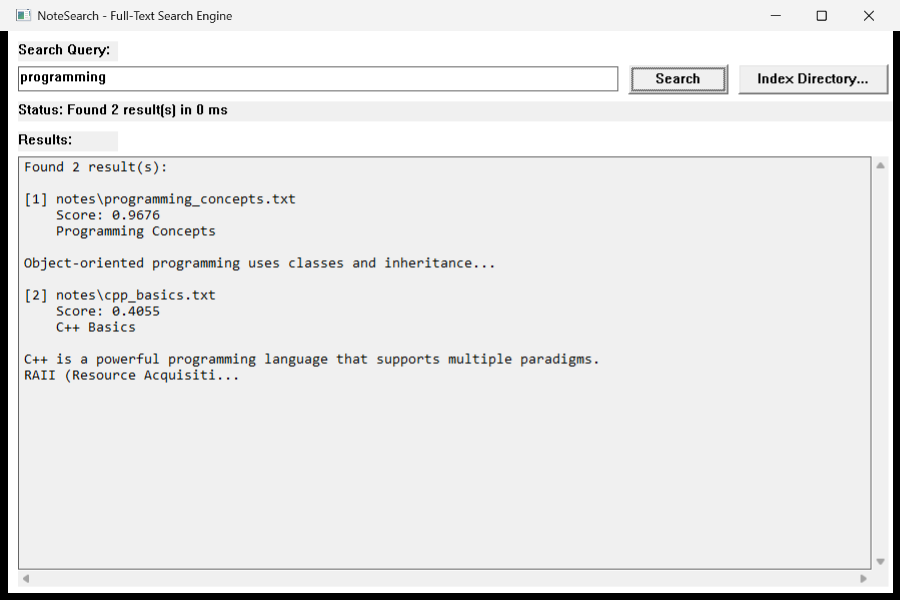

# NoteSearch

local full text search for a notes folder, written in C++17 (Windows).
Started as the project for Fortgeschrittene Programmiertechniken, M.Sc. Mechatronik, FH Wiener Neustadt, WS 2025/26.



## How it works

- `FileScanner` walks the folder recursively and reads text files (.txt, .md, source code, json/yaml/ini, list in `util.cpp`)
- `tokenize()` splits the text into lowercase words with at least 2 characters. Bytes >= 0x80 stay inside the word, so German umlauts in UTF-8 don't break words apart
- `InvertedIndex` maps every word to a posting list: doc id + how often the word is in that doc
- `SearchEngine` runs an AND query, only docs that contain all query words count. Score = sum of TF-IDF over the query words:
  - tf = 1 + log(count in doc)
  - idf = log(number of docs / docs that contain the word)
- results are sorted by score, the snippet is the text around the first hit

The index only lives in memory, nothing is saved. Every start indexes the folder again.

## Building

```bash
cmake -S . -B build
cmake --build build --config Release
```

or in vs code: Ctrl+Shift+P, "CMake: Configure", i chose "Visual Studio Community 2022 Release - amd64".

You get three programs in `build\bin` (with Visual Studio in `build\bin\Release`):

- `notesearch_gui.exe`: the window from the screenshot
- `notesearch.exe`: command line version
- `notesearch_tests.exe`: small tests against `notes_examples`, also runs with `ctest --test-dir build -C Release`

## Usage

GUI: click "Index Directory...", pick the folder, type the words, Enter or Search.
`notesearch_gui.exe C:\path\to\notes` indexes the folder right at the start.

Command line:

```
> notesearch search notes_examples programming
Scanning directory: "notes_examples"
Found 3 indexable files.
Indexing...

Indexing complete!
  Documents indexed: 3
  Unique terms: 127
  Time: 0 ms

Found 2 result(s):

[1] notes_examples\notes\programming_concepts.txt
    Score: 0.9676
    Programming Concepts

Object-oriented programming uses classes and inheritance...

[2] notes_examples\notes\cpp_basics.txt
    Score: 0.4055
    C++ Basics

C++ is a powerful programming language that supports multiple paradigms.
RAII (Resource Acquisiti...

Search completed in 0 ms
```

`programming` is in 2 of 3 files, so idf = log(3/2) = 0.405. In programming_concepts.txt it comes 4 times, tf = 1 + log(4) = 2.39, score 0.97. In cpp_basics.txt once, tf = 1, score 0.41.

Other commands: `notesearch index <folder>` (only stats) and `notesearch interactive <folder>` (search in a loop, `q` to quit).

## Files

```
include/          headers
src/              tokenizer, index, search, file scanner, util, main.cpp (CLI), main_gui.cpp (Win32 GUI)
tests/            test_search.cpp
notes_examples/   3 small notes for trying it out and for the tests
docs/             screenshot
```

## Limits

- no stemming, `pointer` does not find `pointers`
- only AND, no phrase search, no OR
- only ASCII letters get lowercased, so `Ä` and `ä` are different
- the index is not saved to disk
